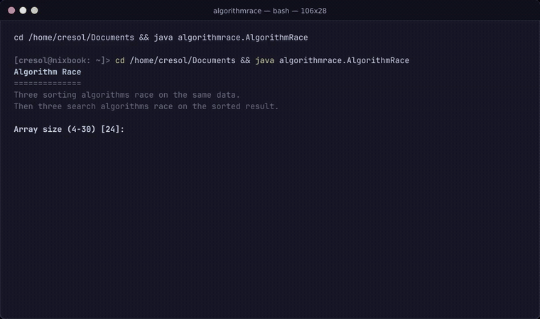

# Algorithm Race

A side-by-side terminal visualizer and benchmarking tool for classic sorting and searching algorithms, implemented in pure Java.

Algorithm Race renders multi-panel ASCII animations in real time, illustrating how different algorithms operate on identical datasets before evaluating their performance through micro-benchmarks.



> [!TIP]
> A high-resolution video is also available in MP4 format at [docs/showcase.mp4](docs/showcase.mp4).

---

## Overview

The application demonstrates algorithm behavior across two distinct phases:

1. **Sorting Race**: Compares **Bubble Sort**, **Insertion Sort**, and **Selection Sort** simultaneously on the same randomized dataset. Real-time operation counters track comparisons and swaps while active elements are highlighted frame-by-frame.
2. **Search Race**: Evaluates **Linear Search**, **Binary Search**, and **Jump Search** on the sorted output across two test cases:
   - **Target Present**: Locating the median array value.
   - **Target Absent**: Searching for an out-of-bounds value to observe worst-case scan behavior.
3. **Performance Report**: Executes automated trials on larger sample sizes ($n = 1200$) to measure wall-clock execution time and calculate average probe counts per key.

---

## Features

- **Multi-Panel ASCII Rendering**: Synchronized side-by-side terminal visualization.
- **Real-Time Operation Tracking**: Live counters for comparisons, element swaps, and search probes.
- **Zero External Dependencies**: Built entirely with standard Java (JDK 8+).
- **Terminal Color Support**: ANSI-colored highlights with automated fallback via the standard `NO_COLOR` environment variable.
- **Automated Validation**: Verifies array ordering and search correctness after every run.

---

## Visual Legend

| Symbol | Color | Description |
| :---: | :---: | :--- |
| `#` | Default | Bar representation of an element value |
| `^` | Yellow | Comparison between two elements |
| `X` | Red | Swap operation between two elements |
| `?` | Cyan | Probe / index inspection during search |
| `!` | Green | Successful target discovery |

---

## Getting Started

### Prerequisites

- **Java Development Kit (JDK)**: Version 8 or higher (tested on OpenJDK 21).
- **Terminal**: Any terminal supporting standard ANSI escape codes (minimum 110 columns × 24 rows recommended).

### Compilation & Execution

#### From the parent directory:
```bash
# Compile all source files
javac algorithmrace/*.java

# Run the application
java algorithmrace.AlgorithmRace
```

#### From inside the project directory:
```bash
# Compile and run with package classpath
javac -d .. *.java
java -cp .. algorithmrace.AlgorithmRace
```

### Configuration Options

Upon startup, the program prompts for dataset parameters:
- **Array size ($4$–$30$)**: Number of elements to visualize (default: `24`).
- **Random seed**: Seed for reproducible pseudorandom array generation (default: `42`).

To run in monochrome mode, set `NO_COLOR`:
```bash
NO_COLOR=1 java algorithmrace.AlgorithmRace
```

---

## Contributing

Contributions are welcome! If you would like to help improve Algorithm Race or implement additional algorithms (such as QuickSort, MergeSort, or Exponential Search), feel free to contribute:

1. **Fork** the repository.
2. **Create** a feature branch (`git checkout -b feature/new-algorithm`).
3. **Commit** your changes (`git commit -m 'Add MergeSort visualization'`).
4. **Push** to the branch (`git push origin feature/new-algorithm`).
5. **Open a Pull Request**.

Please ensure that any new algorithms adhere to the existing [`Race`](file:///home/cresol/Documents/algorithmrace/Race.java) instrumentation model (tracking comparisons, swaps, and probes).

### Contributors

Thanks to everyone who has contributed to this project:

<!-- Add your GitHub username below when contributing -->
- [@cresol](https://github.com/cresol) — *Author and maintainer*

---

## License

This project is open-source and available under the MIT License.
